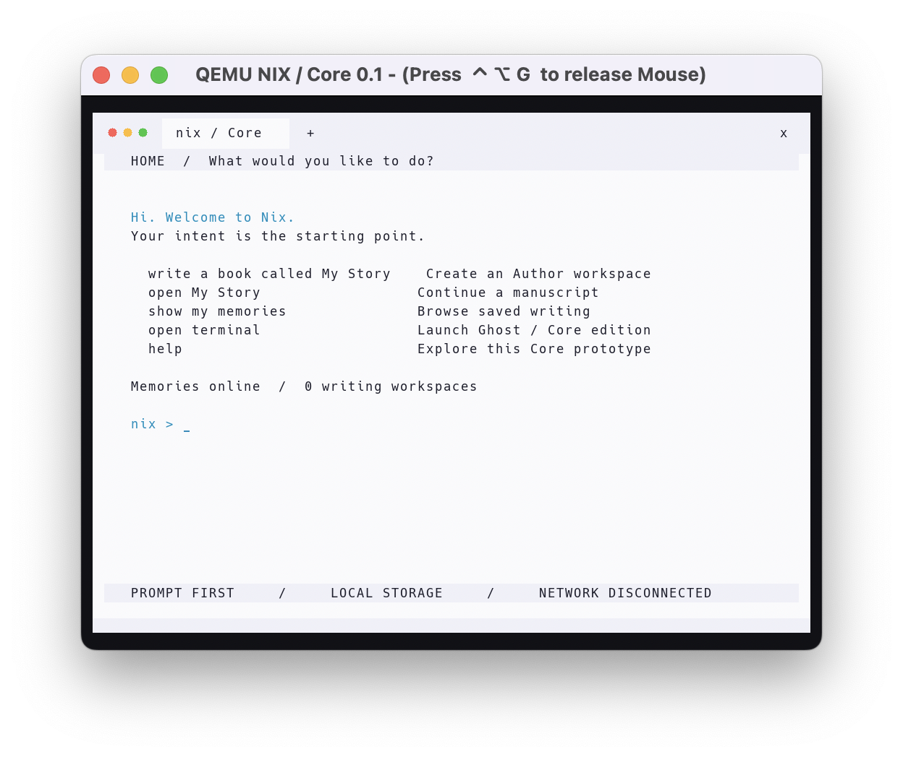

# NIX / Core 0.1

**Version 0.1 · Early bootable MVP · Intel Mac / QEMU**

[**Why Nix?**](marketing.md) — The story, the experience, and the conceptual phases behind the project.

A bootable first slice of the [NIX blueprint](https://core-nix.com/): a prompt-first environment and an Author workspace with persistent Memories. This repository's original `index.html` is the design reference.

**An actual freestanding C/assembly kernel, booted directly by QEMU.** It does not run Linux, a browser, or a host web application. It currently enters 32-bit protected mode on an emulated x86 PC, including your Intel Mac's QEMU x86_64 machine. It is an early kernel prototype, not the proposed 64-bit Rust/C microkernel yet.

## NIX running in QEMU



*Core 0.1 on macOS: the prompt-first Home screen, Author entry points, and the local Memories store. Screenshot supplied October 30, 2026.*

| Detail | Core 0.1 |
| --- | --- |
| Stage | Early bootable operating-system prototype |
| Kernel | Freestanding C and assembly; 32-bit x86 protected mode; single address space |
| Tested host | Intel Mac running QEMU 11.1.3 |
| Virtual machine | Emulated x86 PC, TCG software acceleration, 64 MiB RAM |
| Display | 1024 × 768 framebuffer, Ghost-inspired Light interface, Hack typography |
| Home | Deterministic intent routing; writing and Memories; Ghost opens on request |
| Author | Four manuscripts; up to 4095 bytes each; append, read, undo, save, and reopen |
| Persistence | 4 MiB virtual disk; alternating checksummed snapshots; previous-version recovery; text export |
| Terminal | Ghost Core edition: Memory commands, quoting, command chains, and persistent appends |
| Connectivity | No virtual network device attached |
| Verified behavior | Boot, keyboard input, save/restart, corruption recovery, Ghost commands, export, and missing-disk handling |
| Future work | Local AI, process isolation, full Ghost process/PTY support, x86-64, broader drivers, and isolated Pods |

This version demonstrates the first working slice of NIX. The full operating-system vision and its conceptual phases are described in [Why Nix?](marketing.md).

### Ghost Core edition


## Run on an Intel Mac

Requirements: Xcode command line tools, Homebrew, Python 3, LLVM's ELF linker, and QEMU. In the prepared local workspace, the launcher also discovers the minimal QEMU build under `build/tools`; you can launch directly without finishing a Homebrew QEMU installation.

```sh
xcode-select --install   # only if command line tools are missing
brew install qemu lld
./scripts/run.sh
```

Run these commands from this repository. You can also double-click `Run-NIX.command` after installing dependencies. The first run builds `build/core.elf` and creates a **4 MiB** `build/memories.img`. Later runs preserve that disk. QEMU uses software emulation (TCG) for reliable protected-mode boot; no HVF or nested virtualization is required. The virtual machine has 64 MiB RAM and no network device.

Click inside QEMU to type. Release captured input with **Control + Option + G** (QEMU's macOS grab shortcut), or close its window to quit. Use `shutdown` from NIX Home for a clean exit. For a serial session in your Mac terminal:

```sh
./scripts/run.sh --headless
```

## Try the first experience

```text
nix > write a book called First Light
  + The first chapter starts here.
  + This is running inside Core.
  + :save
  + :home
nix > show my memories
nix > open First Light
  + :read
```

Close QEMU, launch it again, and reopen `First Light`: saved text remains on the virtual disk.

- Home understands `open terminal` / `ghost`, `write a book`, `write a book called <title>`, `open <title>`, `show my memories`, `help`, `status`, `home`, and `shutdown`.
- Author appends one line per Enter. `:save` commits, `:read` shows the manuscript, `:undo` removes the last line in RAM, and `:home` saves before returning. Start a line with `::` to write a literal leading colon.
- Four manuscripts, 47 ASCII characters per title, 4095 bytes per manuscript. Input is ASCII, US keyboard layout, 255 characters per line. The current editor appends lines; it does not support arbitrary cursor editing. Text changes stay in RAM until a successful save.
- Book creation occupies a slot in RAM and becomes persistent at the next save. No deletion command yet.
- Game and wallet intents explain their unimplemented dependencies. They do not install software or create keys.

## Ghost is the default terminal

Ask NIX to `open terminal` (or type `ghost`). Core opens the Ghost port on request;
Home remains the prompt-first intent screen. The framebuffer uses Ghost 0.8.0's
Light colors, pale toolbar, shell tab, window-control colors, and monospace canvas.
The toolbar is decorative in this keyboard-first MVP.

```text
nix > open terminal
ghost /memories > help
ghost /memories > list
ghost /memories > cat "First Light"
ghost /memories > echo "Another line" >> "First Light"
ghost /memories > missing-command || echo recovered
ghost /memories > exit
```

Supported: `help`, `list`/`ls`, `cat`/`spill`, `edit`, `echo`/`print`, `pwd`,
`cd /memories`, `whoami`, `hostname`, `uname`, `clear`, `exit`, quoted words,
`;`, `&&`, `||`, and explicit `echo ... >> "Existing title"` appends. Appends
commit through the Memory store and report a disk error without silently losing
the prior text. `edit <title>` opens Author. Commands are case-sensitive.

The port adapts Ghost's tokenizer to bounded freestanding C and connects built-ins
to Core's Memory broker. The pinned Rust sources are in `third_party/ghost-upstream`;
[provenance and port boundaries](third_party/ghost-upstream/PROVENANCE.md) explain
what is reused and what remains. This is not the macOS Ghost binary: Core has no
POSIX processes, PTYs, egui backend, Swift runtime, pipes, arbitrary filesystem,
or network services yet. Unsupported operators fail explicitly. Destructive
commands and `>` overwrite are unavailable; `>>` is supported for existing Memories.

## Export and backup

Shut down QEMU before accessing the disk from your Mac. To export committed manuscripts to ordinary text files:

```sh
python3 scripts/memory.py list build/memories.img
python3 scripts/memory.py export build/memories.img --output exports
cp build/memories.img ~/Desktop/nix-memories-backup.img
```

The exporter refuses to overwrite existing files. For another export, choose a new output directory. Keep the disk file; rebuilding the kernel preserves it. To start fresh, move the disk to a backup location first, then launch NIX to create a new disk. Never attach a physical disk to this prototype.

## Implementation and verification

`kernel/boot.S` supplies a Multiboot v1 header and stack. `kernel/core.c` contains the deterministic intent router, framebuffer interface (with VGA text fallback), PS/2 keyboard and serial input, polling ATA PIO, and Memory store. `kernel/linker.ld` links the kernel at 1 MiB. QEMU's Multiboot loader loads the ELF via `-kernel`; this is **not** a standalone UEFI/ISO installer. Build needs Clang and `ld.lld`; set `CC` or `LD` to override discovery.

Two alternating 34-sector banks hold complete Memory snapshots. A save writes and flushes the target bank's body, commits its header, flushes, then rereads and validates a checksum. Boot selects the highest valid generation, falling back when a bank is damaged. The checksum detects accidental corruption; it is not cryptographic integrity or encryption. Both banks invalid with nonzero headers disables saves to preserve recovery evidence. There is no general-purpose filesystem or robust storage hardware support.

```sh
./scripts/build.sh
python3 tests/smoke.py
```

The renderer directly configures QEMU Standard VGA through the Bochs VBE interface at 1024x768, discovers the framebuffer through PCI, and draws a software cursor. The antialiased Hack glyph atlas is embedded in `kernel/font.h`, with the font and license retained in `third_party/hack`. `scripts/generate_font.py` regenerates it with Pillow; ordinary builds need no Pillow dependency.

The integration test uses a disposable disk and real QEMU boots. It checks PS/2 keyboard input, serial commands, writing, saving, a full process restart, exclusion of unsaved edits, fallback after deliberately corrupting the latest bank, Ghost quoting/chains/Memory appends, shutdown, and missing-disk behavior. It never mutates your manuscript disk. Framebuffer captures are generated at `build/home.ppm` and `build/ghost.ppm`.

Verified locally on an Intel Mac with Clang 17, LLD 21, and QEMU 11.1.3: all
integration assertions passed, including the 1024x768 framebuffer capture and
host text export. GitHub Actions is configured for the same test; the initial
remote run failed during workflow startup before creating any test jobs.

## Boundary of this MVP

Implemented: boot, Ghost-style framebuffer interface, prompt routing, writing workspace, explicit save, restart persistence, previous-generation recovery, host text export, serial diagnostics, and the Ghost terminal port.

Still needed for the full blueprint: x86-64 long mode, Rust components, paging/process isolation, scheduler/IPC/capabilities, UEFI boot, window compositor, local model inference/OpenCode, real isolated Pods, networking, USB/NVMe, guest virtualization, accelerated graphics and games. All code currently executes at kernel privilege in one address space with interrupts disabled and polled I/O. The Author workspace is a built-in application, not an isolated Pod. No AI model or automatic code generation is included. The framebuffer toolbar is visual chrome; mouse interaction is not implemented.
