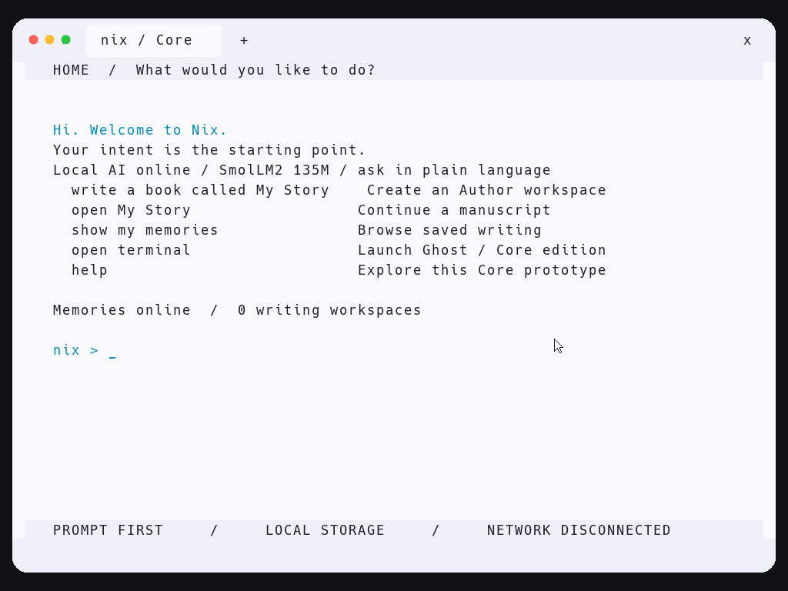
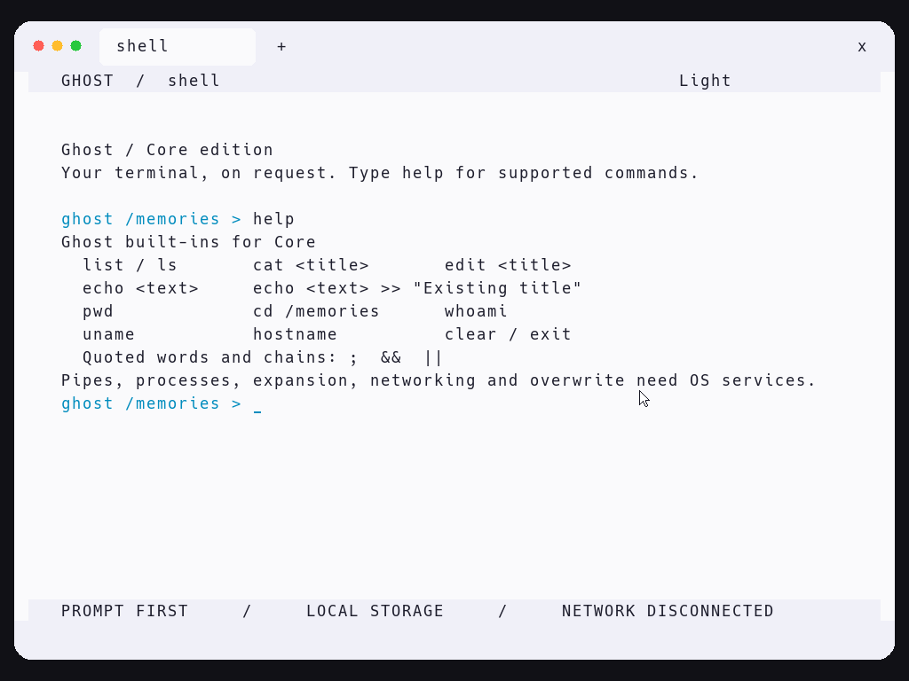
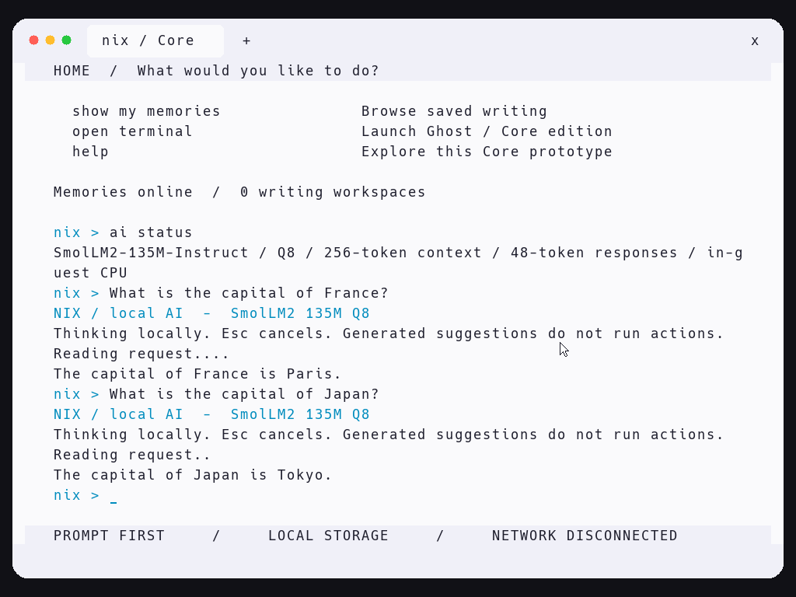

# NIX / Core 0.2

**Version 0.2 · Early bootable MVP · Intel Mac / QEMU**

[**Why Nix?**](marketing.md) — The story, the experience, and the conceptual phases behind the project.

A bootable first slice of the [NIX blueprint](https://core-nix.com/): a prompt-first environment and an Author workspace with persistent Memories. This repository's original `index.html` is the design reference.

**An actual freestanding C/assembly kernel, booted directly by QEMU.** It does not run Linux, a browser, or a host web application. It currently enters 32-bit protected mode on an emulated x86 PC, including your Intel Mac's QEMU x86_64 machine. It is an early kernel prototype, not the proposed 64-bit Rust/C microkernel yet.

## NIX running in QEMU



*Core 0.2 running in QEMU: rounded interface corners, a visible mouse pointer, prompt-first Home, Author entry points, and local Memories. Updated October 30, 2026. [Original macOS window capture](docs/screenshots/nix-core-0.1-qemu.png).*

| Detail | Core 0.2 |
| --- | --- |
| Stage | Early bootable operating-system prototype |
| Kernel | Freestanding C and assembly; 32-bit x86 protected mode; single address space |
| Tested host | Intel Mac running QEMU 11.1.3 |
| Virtual machine | Emulated x86 PC, TCG software acceleration, 512 MiB RAM |
| Display | 1024 × 768 framebuffer, rounded panels and tab, Ghost-inspired Light interface, Hack typography |
| Input | PS/2 keyboard and mouse; software pointer; clickable Home shortcuts and toolbar |
| Home | Local AI answers in plain language, deterministic writing and Memories, Ghost on request |
| Local AI | SmolLM2-135M-Instruct; Q8 weights; SSE2 CPU inference inside Core; 256-token context; 48-token response cap |
| Author | Four manuscripts; up to 4095 bytes each; append, read, undo, save, and reopen |
| Persistence | 4 MiB virtual disk; alternating checksummed snapshots; previous-version recovery; text export |
| Terminal | Ghost Core edition: Memory commands, quoting, command chains, and persistent appends |
| Connectivity | No virtual network device attached |
| Verified behavior | Boot, keyboard input, save/restart, corruption recovery, Ghost commands, export, and missing-disk handling |
| Future work | Multi-turn AI context, validated tool plans, process isolation, full Ghost process/PTY support, x86-64, broader drivers, and isolated Pods |

This version demonstrates the first working slice of NIX. The full operating-system vision and its conceptual phases are described in [Why Nix?](marketing.md).

### Ghost Core edition



## Local AI is inside Core



**Core 0.2 bundles SmolLM2-135M-Instruct with an in-guest CPU inference engine.**
Ask an ordinary question at Home, or use `ask <question>`. `ai status` shows the
loaded model. Escape cancels generation. The launcher attaches the verified
132 MiB model boot module automatically when present; the guest has no network
device and needs no host model server or API key.

[Download Core 0.2 with the model included](https://github.com/Caraveo/nix/releases/tag/v0.2)
for a prebuilt QEMU package. From a fresh source checkout, prepare the model once:

```sh
./scripts/setup-model.sh
./scripts/run.sh
```

The prepared development workspace already contains the downloaded model. Setup
requires internet access to fetch the pinned Apache-2.0 weights and conversion
tools; subsequent launches and inference work offline. Source checkouts without
the bundle still boot with deterministic commands and an explicit model-not-loaded
status. Weights are distributed with the release rather than ordinary Git history.

This is a small model with limited reasoning ability. It can misunderstand requests
and hallucinate. Replies are suggestions, **not executable commands**: the model
cannot invoke Ghost, modify Memories, or install software. Each request starts a
fresh user context; multi-turn chat history and Memory retrieval are future work.
Input is ASCII, total context is 256 tokens, and replies stop after 48 tokens.
See [model provenance, setup, architecture, tests, and limits](models/README.md).

## Run on an Intel Mac

Requirements: Xcode command line tools, Homebrew, Python 3, LLVM's ELF linker, and QEMU. In the prepared local workspace, the launcher also discovers the minimal QEMU build under `build/tools`; you can launch directly without finishing a Homebrew QEMU installation.

```sh
xcode-select --install   # only if command line tools are missing
brew install qemu lld
./scripts/run.sh
```

Run these commands from this repository. You can also double-click `Run-NIX.command` after installing dependencies. The first run builds `build/core.elf` and creates a **4 MiB** `build/memories.img`. Later runs preserve that disk. QEMU uses software emulation (TCG) for reliable protected-mode boot; no HVF or nested virtualization is required. The virtual machine has 512 MiB RAM and no network device. The bundled model is loaded as an immutable Multiboot module, separate from the persistent Memories disk.

Click inside QEMU to type. Release captured input with **Control + Option + G** (QEMU's macOS grab shortcut), or close its window to quit. Use `shutdown` from NIX Home for a clean exit. For a serial session in your Mac terminal:

```sh
./scripts/run.sh --headless
```

## Try the first experience

```text
nix > write a book called First Light
  + The first chapter starts here.
  + This is running inside Core.
  + :save
  + :home
nix > show my memories
nix > open First Light
  + :read
```

Close QEMU, launch it again, and reopen `First Light`: saved text remains on the virtual disk.

- Home understands `open terminal` / `ghost`, `write a book`, `write a book called <title>`, `open <title>`, `show my memories`, `help`, `status`, `home`, and `shutdown`.
- Author appends one line per Enter. `:save` commits, `:read` shows the manuscript, `:undo` removes the last line in RAM, and `:home` saves before returning. Start a line with `::` to write a literal leading colon.
- Four manuscripts, 47 ASCII characters per title, 4095 bytes per manuscript. Input is ASCII, US keyboard layout, 255 characters per line. The current editor appends lines; it does not support arbitrary cursor editing. Text changes stay in RAM until a successful save.
- Book creation occupies a slot in RAM and becomes persistent at the next save. No deletion command yet.
- Game and wallet intents explain their unimplemented dependencies. They do not install software or create keys.

## Ghost is the default terminal

Ask NIX to `open terminal` (or type `ghost`). Core opens the Ghost port on request;
Home remains the prompt-first intent screen. The framebuffer uses Ghost 0.8.0's
Light colors, pale toolbar, shell tab, window-control colors, and monospace canvas.
The PS/2 mouse pointer moves throughout the framebuffer. From Home, click a listed shortcut or the toolbar **+** to open Ghost. In Ghost, **+** clears the shell. The toolbar **x** returns to Home; in Author it saves first. Click actions run only when the input line is empty, so they do not discard a partially typed command or draft. Window dragging, resizing, selection, and the colored window-control dots are not implemented.

```text
nix > open terminal
ghost /memories > help
ghost /memories > list
ghost /memories > cat "First Light"
ghost /memories > echo "Another line" >> "First Light"
ghost /memories > missing-command || echo recovered
ghost /memories > exit
```

Supported: `help`, `list`/`ls`, `cat`/`spill`, `edit`, `echo`/`print`, `pwd`,
`cd /memories`, `whoami`, `hostname`, `uname`, `clear`, `exit`, quoted words,
`;`, `&&`, `||`, and explicit `echo ... >> "Existing title"` appends. Appends
commit through the Memory store and report a disk error without silently losing
the prior text. `edit <title>` opens Author. Commands are case-sensitive.

The port adapts Ghost's tokenizer to bounded freestanding C and connects built-ins
to Core's Memory broker. The pinned Rust sources are in `third_party/ghost-upstream`;
[provenance and port boundaries](third_party/ghost-upstream/PROVENANCE.md) explain
what is reused and what remains. This is not the macOS Ghost binary: Core has no
POSIX processes, PTYs, egui backend, Swift runtime, pipes, arbitrary filesystem,
or network services yet. Unsupported operators fail explicitly. Destructive
commands and `>` overwrite are unavailable; `>>` is supported for existing Memories.

## Export and backup

Shut down QEMU before accessing the disk from your Mac. To export committed manuscripts to ordinary text files:

```sh
python3 scripts/memory.py list build/memories.img
python3 scripts/memory.py export build/memories.img --output exports
cp build/memories.img ~/Desktop/nix-memories-backup.img
```

The exporter refuses to overwrite existing files. For another export, choose a new output directory. Keep the disk file; rebuilding the kernel preserves it. To start fresh, move the disk to a backup location first, then launch NIX to create a new disk. Never attach a physical disk to this prototype.

## Implementation and verification

`kernel/boot.S` supplies a Multiboot v1 header and stack. `kernel/core.c` contains the deterministic intent router, framebuffer interface (with VGA text fallback), PS/2 keyboard and serial input, polling ATA PIO, and Memory store. `kernel/linker.ld` links the kernel at 1 MiB. QEMU's Multiboot loader loads the ELF via `-kernel`; this is **not** a standalone UEFI/ISO installer. Build needs Clang and `ld.lld`; set `CC` or `LD` to override discovery.

Two alternating 34-sector banks hold complete Memory snapshots. A save writes and flushes the target bank's body, commits its header, flushes, then rereads and validates a checksum. Boot selects the highest valid generation, falling back when a bank is damaged. The checksum detects accidental corruption; it is not cryptographic integrity or encryption. Both banks invalid with nonzero headers disables saves to preserve recovery evidence. There is no general-purpose filesystem or robust storage hardware support.

```sh
./scripts/build.sh
python3 tests/smoke.py
```

The renderer directly configures QEMU Standard VGA through the Bochs VBE interface at 1024x768, discovers the framebuffer through PCI, and draws a software cursor. The antialiased Hack glyph atlas is embedded in `kernel/font.h`, with the font and license retained in `third_party/hack`. `scripts/generate_font.py` regenerates it with Pillow; ordinary builds need no Pillow dependency.

The integration test uses a disposable disk and real QEMU boots. It checks rounded corner pixels, PS/2 mouse movement, click-to-open Ghost, pointer trail removal, PS/2 keyboard input, serial commands, writing, saving, a full process restart, exclusion of unsaved edits, fallback after deliberately corrupting the latest bank, Ghost quoting/chains/Memory appends, shutdown, and missing-disk behavior. It never mutates your manuscript disk. Framebuffer captures are generated at `build/home.ppm` and `build/ghost.ppm`.

Verified locally on an Intel Mac with Clang 17, LLD 21, and QEMU 11.1.3: all
integration assertions passed, including the 1024x768 framebuffer capture and
host text export. GitHub Actions is configured for the same test; the initial
remote run failed during workflow startup before creating any test jobs.

## Boundary of this MVP

Implemented: boot, Ghost-style framebuffer interface, rounded corners, PS/2 mouse, local model loading and CPU inference, plain-language AI answers with cancellation, deterministic intent routing, writing workspace, explicit save, restart persistence, previous-generation recovery, host text export, serial diagnostics, and the Ghost terminal port.

Still needed for the full blueprint: x86-64 long mode, Rust components, paging/process isolation, scheduler/IPC/capabilities, UEFI boot, window compositor, larger-model support/OpenCode integration, real isolated Pods, networking, USB/NVMe, guest virtualization, accelerated graphics and games. All code currently executes at kernel privilege in one address space with interrupts disabled and polled I/O. The Author workspace is a built-in application, not an isolated Pod. The model is bundled separately as a verified boot module. Autonomous tool execution and automatic code generation are not implemented. The interface supports a PS/2 pointer and selected click targets; window dragging, resizing, and arbitrary text selection are not implemented.
