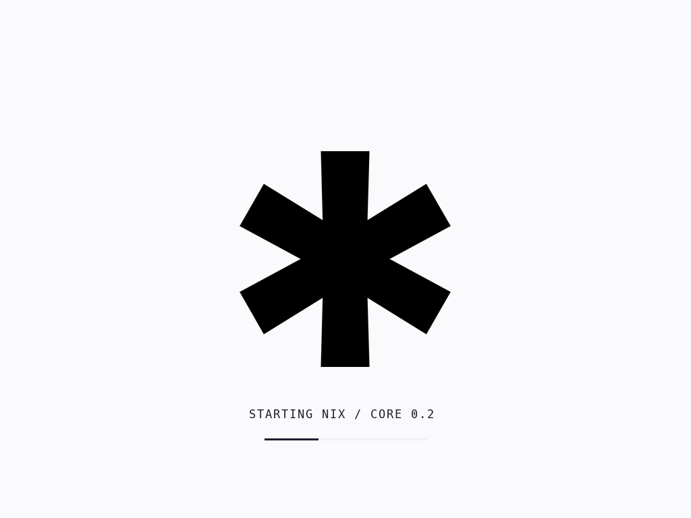
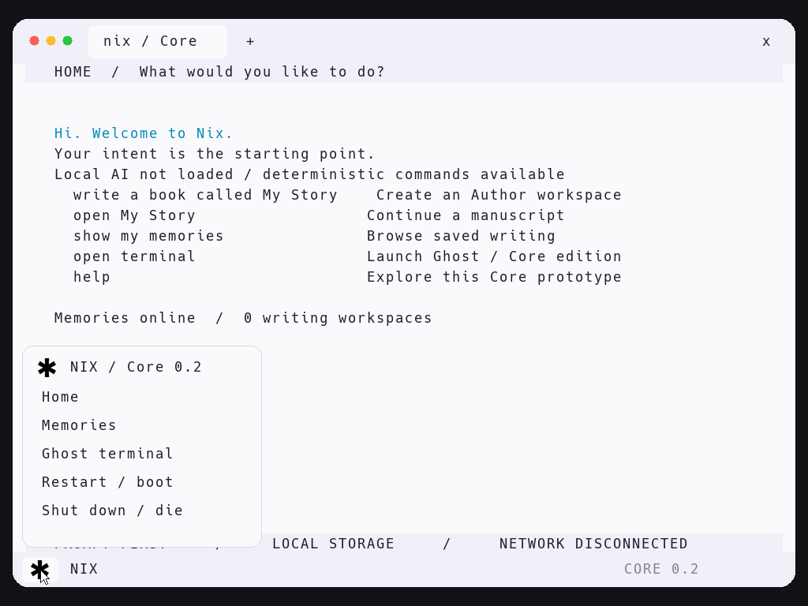

# NIX / Core 0.3

**Version 0.3 · Long mode · QEMU phenom**

[**Why Nix?**](marketing.md) — The story, the experience, and the conceptual phases behind the project.

A bootable first slice of the [NIX blueprint](https://core-nix.com/): a prompt-first environment and an Author workspace with persistent Memories. This repository's original `index.html` is the design reference.

**An actual freestanding C/assembly kernel, booted directly by QEMU.** NIX is the host and is not Linux. A 32-bit Multiboot stub switches to 64-bit long mode and runs the kernel. Author runs as a ring-3 pod. A dios-confirmed build runs in an AMD SVM guest with nested paging. `dios` is the root principal. The named physical PC is [NIX Station 1](docs/nix-station-1.md). This tree has not booted that PC. Acceptance is QEMU.

The intended NIX system combines the machine startup role of UEFI/BIOS with the operating system in one environment owned by dios. NIX owns the machine; Linux kernels are optional guest instances copied from a built template. The current implementation enters through Multiboot. A native UEFI startup path and physical hardware boot remain future work.

NIX virtualizes **intents**. An intent can be a full operating system, container, pod, service, application, game, or another workload. A kernel is an execution mechanism for an intent; NIX owns the intent's resources, lifecycle, and interface. These workload types describe the intended model, not a claim that every runtime is implemented today.

## NIX running in QEMU


*Checked-in captures are from the Core 0.2 window. The live status line is Core 0.3. Rounded corners, the pointer, Home, and Author are unchanged. [Original macOS window capture](docs/screenshots/nix-core-0.1-qemu.png).*

| Detail | Core 0.3 |
| --- | --- |
| Stage | NIX host, native pods, build guest, and up to four Linux intent runtimes |
| Kernel | Freestanding C and assembly; x86-64 long mode; ring-3 pods; cooperative, interrupts masked |
| Tested host | Intel Mac running QEMU 11.1.3 |
| Virtual machine | `-machine pc,accel=tcg -cpu phenom`, 8 GiB windowed / 512 MiB headless, std VGA, IDE, PS/2; per-intent networking in full mode |
| Display | 1024 × 768 framebuffer, rounded panels and tab, Ghost-inspired Light interface, Hack typography |
| Input | PS/2 keyboard and mouse; software pointer; clickable Home shortcuts and toolbar |
| Home | Local AI answers in plain language, deterministic writing and Memories, Ghost on request |
| Local AI | SmolLM2-135M-Instruct; Q8 weights; SSE2 CPU inference inside Core; 256-token context; 48-token response cap. Answers are not authority |
| Author | Ring-3 pod. Four manuscripts; up to 4095 bytes each; append, read, undo, save, and reopen |
| Persistence | 4 MiB virtual disk; alternating checksummed snapshots; previous-version recovery; text export |
| Build | Local catalog with one recipe, `count-words`. dios confirms. AMD SVM + nested paging. Reuse and rollback |
| Terminal | Ghost Core edition: Memory commands, quoting, command chains, and persistent appends. `whoami` prints `dios` |
| Connectivity | No virtual network device. `fetch` is denied |
| Verified behavior | `tests/smoke.py`, `tests/power.py`, and `tests/phase4.py` on QEMU phenom |
| Not in this tree | Physical boot, board drivers, UEFI, a general compiler, preemption, and model tool use |

This version demonstrates the first working slice of NIX. The full operating-system vision and its conceptual phases are described in [Why Nix?](marketing.md).

### Ghost Core edition


## Local AI is inside Core


**Core runs SmolLM2-135M-Instruct with an in-guest CPU inference engine.**
Ask an ordinary question at Home, or use `ask <question>`. `ai status` shows the
loaded model. Escape cancels generation. The launcher attaches the verified
132 MiB model boot module automatically when present; the guest has no network
device and needs no host model server or API key.

The last tagged model package is the [Core 0.2 release](https://github.com/Caraveo/nix/releases/tag/v0.2). This tree is 0.3 and is not that package.
For the source tree, `make package` produces a ZIP containing the kernel,
model, licenses, and launch scripts. From a fresh source checkout, prepare the model once:

```sh
./scripts/setup-model.sh
./scripts/run.sh
```

The prepared development workspace already contains the downloaded model. Setup
requires internet access to fetch the pinned Apache-2.0 weights and conversion
tools; subsequent launches and inference work offline. Source checkouts without
the bundle still boot with deterministic commands and an explicit model-not-loaded
status. Weights are distributed with the release rather than ordinary Git history.

This is a small model with limited reasoning ability. It can misunderstand requests
and hallucinate. Replies are suggestions, **not executable commands**: the model
cannot invoke Ghost, modify Memories, or install software. Each request starts a
fresh user context; multi-turn chat history and Memory retrieval are future work.
Input is ASCII, total context is 256 tokens, and replies stop after 48 tokens.
See [model provenance, setup, architecture, tests, and limits](models/README.md).

## Run on an Intel Mac

Requirements: Xcode command line tools, Homebrew, Python 3, LLVM's ELF linker, and QEMU. In the prepared local workspace, the launcher also discovers the minimal QEMU build under `build/tools`; you can launch directly without finishing a Homebrew QEMU installation.

```sh
xcode-select --install   # only if command line tools are missing
brew install qemu lld
./scripts/run.sh
```

Run these commands from this repository. You can also double-click `Run-NIX.command` after installing dependencies. The first run builds `build/core.elf` and creates a **4 MiB** `build/memories.img`. Later runs preserve that disk. QEMU uses TCG and `-cpu phenom` because this QEMU's TCG can execute AMD SVM and cannot execute Intel VMX. The windowed virtual machine has 8 GiB RAM and a separate sparse 10 GiB install disk on IDE slave. Headless mode uses 512 MiB RAM. Headless mode has no network device. With the full Linux template prepared, windowed mode attaches four separate PIO network adapters with private NAT backends, one per Linux intent. NIX requires 8 GiB of memory; 10 GiB is the minimum install disk size. QEMU needs its user network backend (libslirp) for this mode. Catalog `fetch` stays denied. The host does not need nested virtualization. The bundled model is loaded as an immutable Multiboot module, separate from the persistent Memories disk. The boot stub copies that module to 256 MiB before it clears kernel memory, which is what keeps the weights intact. A boot without the bundle leaves local AI off.

The built Linux 7.3.1 image is a reusable template: each new kernel instance copies it into private RAM, with its own RAM, guest disk, and saved CPU/FPU/device state. Full userspace instances receive 512 MiB RAM and a 64 MiB scratch disk; the compact fallback keeps 48 MiB RAM and 16 MiB disk. `ask kernel`, then `y`, opens `#kernel`. `ask kernel again` opens `#kernel0`, then `#kernel1`; `ask kernel -n linux` opens `#linux`. Up to four guests can stay open. Click Prompt, Terminal, or a kernel tab to switch; guests pause when left. Type `nix` and Enter to close the selected guest. A repeated name without an explicit replacement request is preserved. The original compact diagnostic build has a small shell. After preparing the full runtime, the userspace archive is required; an absent template produces a launch message instead of starting an incomplete guest. With the full template, it runs Debian userspace with Bash, curl, wget, ping, Python, Git, apt, and standard Linux utilities. Names such as `#ubuntu` label instances of the same prepared template; they do not select a different distribution. Unnamed instances use RAM-backed scratch filesystems. With the dedicated instance store attached by `scripts/run.sh`, `ask kernel -n work` creates a saved instance with a 20 GiB disk. Its whole writable filesystem (including `/etc`, installed packages, and source files) overlays the reusable base template. Repeating `ask kernel -n work` or using `ask open work` reopens it. `ask kernel -n work again` creates a fresh named clone of the base. `ask list` lists saved and running instances; `nix` flushes and stops the current guest. `ask delete --confirm work` deletes its saved registry entry after it has stopped. Deletion is not a secure erase. The store supports six saved instances and the runtime supports four live guests. The sparse `build/instances.img` is 128 GiB logically and lives on a separate secondary IDE device; it does not replace Memories or the install disk. Preserve this file to preserve named instances. The first start formats the new instance and can take a few minutes under TCG.

Prepare the full Linux intent runtime with Docker running:

```sh
sh scripts/linux-runtime.sh
./scripts/run.sh
```

The userspace archive is loaded once at a reserved host RAM address and copied into each new guest. The kernel image and userspace archive are reusable templates; a new tab does not rebuild Linux or install packages on the Mac. `tests/linuxfull.py` checks real programs, downloads, DNS, and HTTPS inside NIX. The catalog command `fetch` retains its separate deny policy.

Each console shows 24 lines and keeps 1,024 lines of scrollback per tab. Scroll with the mouse wheel or scrollbar; use Shift+PageUp/PageDown in Linux app tabs (PageUp/PageDown in Prompt and Terminal). Switching tabs preserves the scroll position.

Click inside QEMU to type. Release captured input with **Control + Option + G** (QEMU's macOS grab shortcut), or close its window to quit. Use `die` (or its `shutdown` alias) and confirm with `y` for a clean exit. `n` cancels. Use `boot` to restart the guest. For a serial session in your Mac terminal:

```sh
./scripts/run.sh --headless
```

## NIX emblem, system menu, and power commands



Core embeds the alpha mask from your original black `assets/brand/NIX.png` logo.
It appears large and centered during boot, then as a small button at the bottom
left of the interface. Click the emblem to open the NIX menu, or type `menu`.
The menu opens Home, Memories, or Ghost, and offers Restart and Shut down.



| Command | Behavior |
| --- | --- |
| `die` | Shows a caution and a y/n prompt. `y` saves a dirty Author draft, flushes storage, and powers off. `n` or an empty answer cancels. Other answers leave the confirmation pending. |
| `shutdown` | Alias of `die`, with the same confirmation. |
| `boot` | Saves a dirty draft, flushes storage, and resets the guest. Boot splash, model, and saved Memories are loaded again. |
| `menu` | Opens or closes the bottom-left NIX menu. |

In Author, use `:die`, `:boot`, or `:menu` so ordinary manuscript words remain
text. The menu handles those context differences for you. A failed draft save
or disk flush cancels the power transition and leaves the OS running. A shutdown
request stops any remaining commands in that Ghost command chain.

The splash is briefly visible on every cold boot and restart. Generated logo
masks are compiled into the kernel; no image viewer, filesystem, or model is
needed to display them. `scripts/generate_logo.py` regenerates the masks with
Pillow while leaving the original artwork unchanged.

## Try the first experience

```text
nix > write a book called First Light
  + The first chapter starts here.
  + This is running inside Core.
  + :save
  + :home
nix > show my memories
nix > open First Light
  + :read
```

Close QEMU, launch it again, and reopen `First Light`: saved text remains on the virtual disk.

- Home understands `open terminal` / `ghost`, `write a book`, `write a book called <title>`, `open <title>`, `show my memories`, `help`, `status`, `home`, and `shutdown`.
- `build count-words` asks dios to confirm, then installs the catalog pod. A second `build count-words` reuses it. `run counter` counts words. `fetch` stays denied. `rollback counter` restores the previous pod. Details and the hardware target are in [NIX Station 1](docs/nix-station-1.md).
- Author appends one line per Enter. `:save` commits, `:read` shows the manuscript, `:undo` removes the last line in RAM, and `:home` saves before returning. Start a line with `::` to write a literal leading colon.
- Four manuscripts, 47 ASCII characters per title, 4095 bytes per manuscript. Input is ASCII, US keyboard layout, 255 characters per line. The current editor appends lines; it does not support arbitrary cursor editing. Text changes stay in RAM until a successful save.
- Book creation occupies a slot in RAM and becomes persistent at the next save. No deletion command yet.
- Game and wallet intents explain their unimplemented dependencies. They do not install software or create keys.

## Ghost is the default terminal

Ask NIX to `open terminal` (or type `ghost`). Core opens the Ghost port on request;
Home remains the prompt-first intent screen. The framebuffer uses Ghost 0.8.0's
Light colors, pale toolbar, shell tab, window-control colors, and monospace canvas.
The PS/2 mouse pointer moves throughout the framebuffer. From Home, click a listed shortcut or the toolbar **+** to open Ghost. In Ghost, **+** clears the shell. The toolbar **x** returns to Home; in Author it saves first. Click actions run only when the input line is empty, so they do not discard a partially typed command or draft. Window dragging, resizing, selection, and the colored window-control dots are not implemented.

```text
nix > open terminal
ghost /memories > help
ghost /memories > list
ghost /memories > cat "First Light"
ghost /memories > echo "Another line" >> "First Light"
ghost /memories > missing-command || echo recovered
ghost /memories > exit
```

Supported: `help`, `list`/`ls`, `cat`/`spill`, `edit`, `echo`/`print`, `pwd`,
`cd /memories`, `whoami` (prints `dios`; dios is root), `hostname`, `uname`, `clear`, `exit`, quoted words,
`;`, `&&`, `||`, and explicit `echo ... >> "Existing title"` appends. Appends
commit through the Memory store and report a disk error without silently losing
the prior text. `edit <title>` opens Author. Commands are case-sensitive.

The port adapts Ghost's tokenizer to bounded freestanding C and connects built-ins
to Core's Memory broker. The pinned Rust sources are in `third_party/ghost-upstream`;
[provenance and port boundaries](third_party/ghost-upstream/PROVENANCE.md) explain
what is reused and what remains. This is not the macOS Ghost binary: Core has no
POSIX processes, PTYs, egui backend, Swift runtime, pipes, arbitrary filesystem,
or network services yet. Unsupported operators fail explicitly. Destructive
commands and `>` overwrite are unavailable; `>>` is supported for existing Memories.

## Export and backup

Shut down QEMU before accessing the disk from your Mac. To export committed manuscripts to ordinary text files:

```sh
python3 scripts/memory.py list build/memories.img
python3 scripts/memory.py export build/memories.img --output exports
cp build/memories.img ~/Desktop/nix-memories-backup.img
```

The exporter refuses to overwrite existing files. For another export, choose a new output directory. Keep the disk file; rebuilding the kernel preserves it. To start fresh, move the disk to a backup location first, then launch NIX to create a new disk. Never attach a physical disk to this prototype.

## Implementation and verification

`kernel/stub.S` is the Multiboot v1 image QEMU loads. It switches to long mode and jumps to the ELF64 kernel at 2 MiB. `kernel/core.c` contains the intent router, framebuffer (with VGA text fallback), PS/2 input, polling ATA PIO, and the Memory store. `kernel/pod.h` maps ring-3 pods and runs the build guest. QEMU's `-kernel` path is **not** a UEFI or ISO installer. Build needs Clang and `ld.lld`; set `CC` or `LD` to override discovery.

Two alternating 34-sector banks hold complete Memory snapshots. A save writes and flushes the target bank's body, commits its header, flushes, then rereads and validates a checksum. Boot selects the highest valid generation, falling back when a bank is damaged. The checksum detects accidental corruption; it is not cryptographic integrity or encryption. Both banks invalid with nonzero headers disables saves to preserve recovery evidence. There is no general-purpose filesystem or robust storage hardware support.

```sh
./scripts/build.sh
python3 tests/smoke.py
python3 tests/power.py
python3 tests/phase4.py
```

The renderer directly configures QEMU Standard VGA through the Bochs VBE interface at 1024x768, discovers the framebuffer through PCI, and draws a software cursor. The antialiased Hack glyph atlas is embedded in `kernel/font.h`, with the font and license retained in `third_party/hack`. `scripts/generate_font.py` regenerates it with Pillow; ordinary builds need no Pillow dependency.

`tests/smoke.py` and `tests/power.py` use a disposable disk and real QEMU boots. They check rounded corner pixels, PS/2 mouse movement, click-to-open Ghost, pointer trail removal, PS/2 keyboard input, serial commands, writing, saving, a full restart, exclusion of unsaved edits, fallback after deliberately corrupting the latest bank, Ghost quoting, chains, Memory appends, shutdown, and missing-disk behavior. `tests/phase4.py` checks the dios confirm, the nested-page-fault probe, install, reuse, a denied Memory, a granted Memory the guest never sees, rollback, and a pod fault that leaves the shell running. None of these tests mutates `build/memories.img`. Framebuffer captures are generated at `build/home.ppm` and `build/ghost.ppm`.

Verified locally on an Intel Mac with Clang 17 and QEMU 11.1.3: `tests/smoke.py`, `tests/power.py`, and `tests/phase4.py` passed, including the 1024×768 framebuffer checks and host text export. GitHub Actions runs those three tests. This session did not watch a remote run.

## Boundary of this MVP

Implemented: long-mode boot under QEMU phenom, the framebuffer and PS/2 pointer, local CPU inference, deterministic intent routing, Author as a ring-3 pod, save and restart, bank recovery, host export, the Ghost port, and a dios-confirmed SVM build guest for the one catalog recipe. dios is root.

Still outside this tree: booting NIX Station 1, UEFI, Rust, preemptive scheduling, a general compiler, OpenCode, networking, USB, NVMe, Wi-Fi, audio, and a discrete or integrated GPU driver. Interrupts stay masked. The model stays in the kernel and cannot confirm a plan. The build guest's 2 MiB map is writable and executable; nested paging is the boundary. Native pods refuse a segment that is both writable and executable. The pointer hits selected targets only. Window dragging, resizing, and arbitrary text selection are not implemented.
